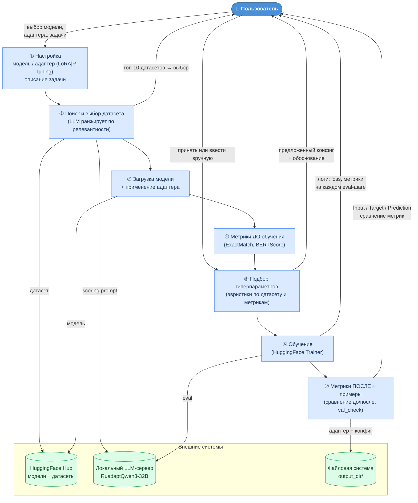

## Точки обратного отклика с пользователем

| # | Когда | Что |
|---|-------|-----|
| ① | Старт | Выбор модели, адаптера, ввод описания задачи |
| ② | После поиска | Показ топ-10 датасетов с оценками → выбор id |
| ③ | После baseline | Предложенные гиперпараметры + объяснение → принять / ввести вручную |
| ④ | Во время обучения | Онлайн-логи: loss, ExactMatch, BERTScore на каждом eval-шаге |
| ⑤ | После обучения | Примеры Input/Target/Prediction + сравнение метрик до и после |
