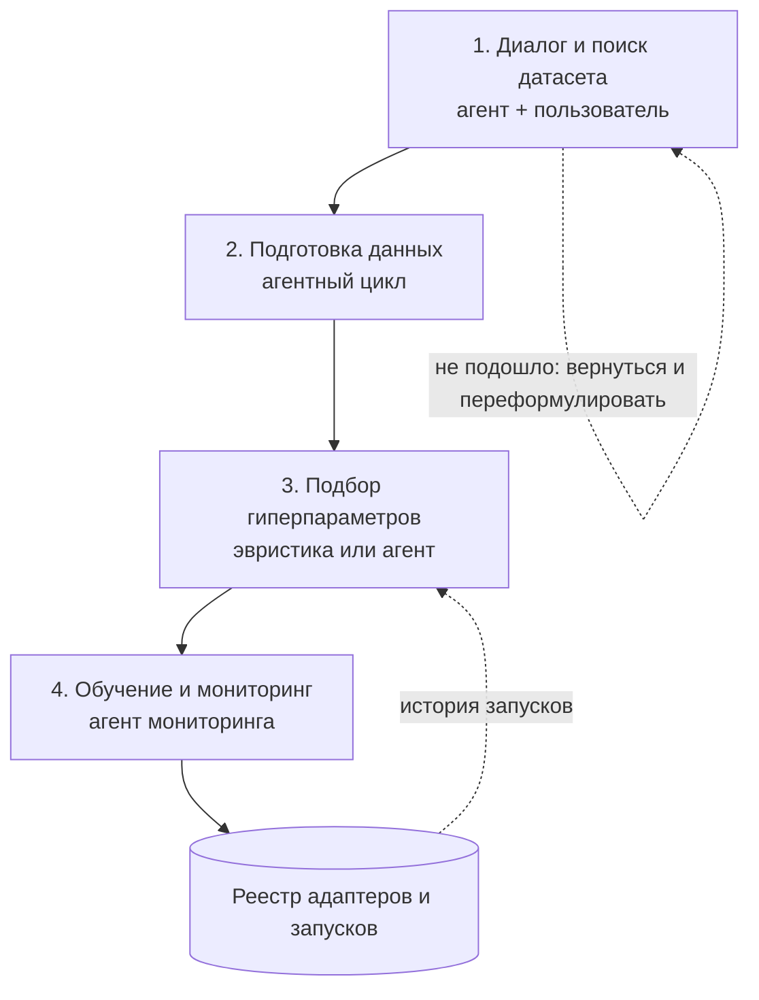

# Архитектура: агентная система автоматического дообучения LLM под NLP-задачи

> Для кодинг-агента: у тебя есть код предыдущей версии (курсовая «Библиотека адаптеров для задач NLP»). **Не переписывай то, что уже работает: оборачивай и переноси.**

Пользователь описывает NLP-задачу в чате. Система уточняет постановку, находит и готовит датасет, подбирает конфигурацию дообучения (LoRA/QLoRA/P-tuning), обучает адаптер, следит за обучением и выдаёт результат: адаптер, метрики и сравнение с простыми baseline'ами.

Это **агентная система с детерминированным каркасом**: четыре LLM-агента с ограниченной автономией встроены в фиксированный сценарий. Всё, что можно сделать обычным кодом (поиск, обучение, метрики, сохранение), делается кодом и доступно агентам как инструменты. Агенты отвечают за решения («что делать и почему») и за диагностику («почему не сработало»).

## 2. Общая схема



Соответствие исходной схеме проекта: шаги 1–3 → блок 1; шаг 4 → блок 2; шаг 5 → блок 3; шаги 6–7 объединены в блок 4.

**Агенты** (pydantic_ai; роль LLM — оркестратор, конфигурируется): A1 Intake (блок 1), A2 DataPrep (блок 2), A3 HParam (блок 3, вариант B), A4 Monitor (блок 4). Остальные LLM-вызовы — функции без состояния (расширение запроса, оценка датасета по критериям).

**Общие правила:** контракты между модулями — pydantic-модели (§4); любой выход LLM, влияющий на исполнение, проходит проверку схемы и guard; метрики не выбирает LLM (они заданы для типа задачи); test закрыт до окончательной остановки обучения; всё хранится в файлах (§5), без СУБД.

## 3. Блоки

### 3.1 Диалог и поиск датасета (шаги 1–3): цикл с участием человека

Агент A1 опрашивает пользователя, пока постановка не станет однозначной: тип задачи (NER | QA | Text Classification | Summarization | Sentiment Analysis), язык, набор меток, ограничения (время, размер модели, лицензия, **метод адаптации: авто / LoRA / QLoRA / P-tuning**), базовая модель. Результат показывается карточкой, которую пользователь правит и подтверждает. Метрики не придумывает ни пользователь, ни LLM: они заранее заданы для каждого типа задачи (`registry/tasks.yaml`: список метрик, основная, процедура оценки, набор baseline'ов).

Затем запускается поиск датасета как воронка «дешёвое на многом, дорогое на малом»:

1. кэшированный каталог датасетов Hugging Face (с фильтрами из курсовой: язык, наличие описания, достаточно примеров на нужном языке) ✅ ЛИБО переданный пользователем датасет в формате, совместимом с pandas/polars;
2. гибридный поиск (смысловой + BM25) и реранкинг специализированной моделью;
3. детерминированная проверка совместимости с задачей (есть ли нужные колонки, подходят ли метки, лицензия);
4. только для нескольких финалистов LLM оценивает датасет по нескольким критериям на нескольких примерах.

Пользователь выбирает датасет: ему показывают название, скор и почему датасет подходит под его задачу. Если ничего не подошло, цикл возвращается к диалогу: агент предлагает переформулировать задачу или ослабить ограничения.

**Детали воронки.** Эмбеддинги описаний считаются офлайн при построении кэша. Онлайн: BM25 и dense дают по списку → RRF (`score = Σ 1/(60 + rank)`) → top-50 → cross-encoder →  top-10 финалистов в LLM-оценку. Критерии LLM-оценки: релевантность задаче, соответствие меток, достаточность размера, качество текста, соответствие домену, надёжность разметки (0–5 каждый + краткое обоснование); итоговый скор — взвешенная сумма в коде (веса в `config.yaml` ⚠️). Карточка датасета: название, скор 0–100, «почему подходит» (из обоснования LLM-оценки), детали — по раскрытию.

**Ход диалога.** Один ход пользователя = один вызов `agent.run`; история сохраняется между ходами (§5). Выход A1 — один из типов: `AskUser` (вопрос + кнопки), `ProposeSpec` (карточка `TaskSpec`), `PresentDatasets` (кандидаты). `primary_metric`/`metrics` в `TaskSpec` подставляет код из реестра задач поверх ответа LLM. Базовая модель: из реестра моделей (`registry/models.yaml`: id, число параметров, имена LoRA-модулей `attention`/`all_linear`, флаги поддержки Unsloth/P-tuning, шаблон чата); LLM выбирает только из отфильтрованного кодом списка.

### 3.2 Подготовка данных (шаг 4): отдельный агентный цикл

Сначала всегда выполняется обязательная часть без LLM-решений: разбиение на train/val/test (test сразу закрывается), приведение датасета к формату задачи, профиль данных (баланс классов, длины, дубликаты, пустые, язык).

Дальше статистические правила решают, нужна ли чистка. Если всё в порядке, агент не вызывается. Если нет или случай неоднозначный, агент A2 в формате ReAct работает с набором инструментов подготовки данных (профиль, выборка, поиск подозрительных меток, удаление дубликатов, фильтрация, балансировка, аугментация) на небольшой выборке train. Итог его работы — воспроизводимый **рецепт** подготовки, который затем применяется ко всему датасету обычным кодом. Если рецепт удаляет много данных, нужно подтверждение пользователя.

Агент не проверяет «фактические ошибки» в текстах (без источников LLM может только выдумывать): он работает с шумом меток, дубликатами, мусором, балансом классов. Аугментированные данные, если создаются, помечаются и попадают только в train.

**Инструменты A2** (все возвращают сводки, не сырые данные; работают на выборке train ≤ несколько тысяч строк): `profile`, `sample`, `label_issues` (cleanlab `find_label_issues` по out-of-sample вероятностям TF-IDF+LogReg), `dedupe` (exact / near через MinHash `datasketch`), `filter` (условие из закрытого набора полей: длина, язык, метка, признак дубля), `rebalance` (undersample / oversample повтором), `augment` (опционально; помечает `synthetic=true`), `diff` (профиль до/после), `commit_recipe`. Операции рецепта: `map_schema`, `dedupe`, `filter`, `drop_label_noise` (не более доли train из конфига), `rebalance`, `augment`. Агенту недоступны val/test и произвольный код. Если агент исчерпал лимиты — рецепт строится только из правил.

> **Аугментация может быть не просто аугментацией, а полноценным синтезом данных через агента: данные должны быть похожи на исходный датасет. Решение: взять сэмпл данных и на его основе генерировать, с возможностью запуска параллельных субагентов ИЛИ с помощью написания кода для детерменированной аугментации путем синонимизации / изменения формы предложений ИЛИ гибрид. Запускать с одобрения пользователя в режиме ЭКСПЕРТ, или автоматически при УВЕРЕННОМ РЕШЕНИИ (у агента высокая confidence) в режиме АВТО.**

### 3.3 Подбор гиперпараметров (шаг 5): два взаимозаменяемых варианта

Оба варианта выдают одну и ту же конфигурацию обучения (`RunConfig`), поэтому их можно сравнить в экспериментах; вариант выбирается флагом `HPARAM_STRATEGY`.

- **Вариант A — эвристика (заглушка).** Правила из курсовой (по размеру датасета и метрикам до обучения) ✅; позже — классификаторы/регрессия поверх накопленной истории запусков.
- **Вариант B — агент A3.** Смотрит статистику наиболее похожих прошлых запусков и документацию по гиперпараметрам, подбирает параметры и обосновывает каждый выбор ссылкой на свидетельства (запуск или фрагмент документации).

В обоих случаях выход проходит защитный слой (guard): допустимые диапазоны, проверка по памяти GPU, имена модулей берутся из реестра моделей, а не от LLM. Затем идёт короткий пробный прогон: он ловит расхождение и нехватку памяти и даёт честную оценку времени. Пользователь видит конфигурацию с обоснованиями и подтверждает её.

**Кто что решает.** Стратегия (A или B): скорость обучения, число эпох (верхняя граница), для LoRA — `r`, `alpha`, вариант; для P-tuning — число виртуальных токенов, размер и тип энкодера подсказок. Код: `max_seq_len` (по квантилям длин профиля, не больше лимита модели), размер батча и накопление градиента (по VRAM), квантизация (по VRAM: помещается без квантизации — без неё, иначе 4-bit; при явном выборе пользователя — как выбрал), имена `target_modules` (реестр), warmup, weight decay, patience раннего останова, сиды (`split_seed` один на датасет, `train_seed` на запуск), частоты логирования/валидации (по умолчанию 50 и 400 шагов ✅, для малых данных — не реже двух раз за эпоху).

**A3.** Тулы: `find_similar_runs` (сводка по завершённым запускам из `runs/*/manifest.json`: похожие по типу задачи, языку, размеру модели, числу примеров, числу классов; метрика — **val**, не test), `lookup_hparam_docs` (поиск по папке заметок/документации `docs/hparams/`, у каждого фрагмента `doc_chunk_id`), `estimate_resources`, `run_pilot`. Вывод — `RunConfig` с обоснованием для каждого параметра; нет похожих запусков — агент так и пишет (cold start). При ошибке/недоступности LLM — автоматический возврат на вариант A.

**Пилот.** Короткий прогон (малая доля шагов, не менее ~20): ловит NaN/OOM, меряет токены/с и пиковую память → оценка времени (верхняя граница). Авто-исправления, не более двух попыток: OOM → меньше micro-batch и больше накопление (эффективный батч тот же) → gradient checkpointing → QLoRA; NaN → lr/2 и больше warmup. Не помогло — отчёт пользователю.

### 3.4 Обучение и мониторинг (шаги 6–7): единый агент мониторинга

Обучение идёт фоновой задачей в отдельном процессе (закрытая вкладка его не останавливает). Пользователь видит прогресс, оценку оставшегося времени и живые метрики.

Постоянно работают простые детерминированные детекторы (loss ушёл в NaN или скачет, метрика на валидации застряла, началось переобучение, упала скорость, модель стала предсказывать один класс). Жёсткие сбои (нехватка памяти, NaN) обрабатываются правилами. Если же статистика отклоняется «мягко», вызывается **агент мониторинга** A4: он оценивает, корректно ли идёт обучение, и решает — продолжать, внести небольшую безопасную поправку (например, снизить learning rate), досрочно остановить. Его полномочия ограничены: число вмешательств на запуск лимитировано, менять модель, датасет или test он не может.

После обучения код сравнивает результат с простыми baseline'ами (мажоритарный класс, исходная модель с промптом). Агент мониторинга пишет итоговый диагноз и сохраняет чекпоинт (веса адаптера, состояние оптимизатора и шедулера), чтобы обучение можно было продолжить с текущего места. Если качество достаточное, агент **окончательно останавливает обучение**; иначе спрашивает пользователя: остановить, перезапустить с другими параметрами или продолжить с текущего места ещё на N эпох.

⚠️ **Единственное уточнение к схеме:** метрики на закрытом test считаются **один раз — при окончательной остановке**; решения «продолжить / перезапустить / остановить» после промежуточных раундов принимаются по val (иначе test превращается в часть цикла подбора). Baseline'ы для промежуточных раундов считаются на val.

**Детекторы** (чистые функции над окном `MetricPoint`; пороги в `config.yaml` ⚠️): `nan_loss`, `plateau` (метрика на val не растёт, loss ещё падает), `overfit` (val loss растёт при падающем train loss), `grad_explosion`, `throughput_drop` (относительно пилота), `oom_risk`, `prediction_collapse` (почти все предсказания — один класс). Жёсткие сбои без агента: NaN → остановка и resume с lr/2 (один раз); OOM → лестница из пилота; зависший процесс → уведомление пользователя.

**Раунды и продолжение.** Раунд завершается чекпоинтом `rounds/round_k/checkpoint-N` (в нём `optimizer.pt`, `scheduler.pt`, `trainer_state.json`; `save_only_model=False`) и копией лучшего адаптера. После раунда A4 получает val-метрики и baseline'ы на val и возвращает диагноз с рекомендацией `finish` / `continue` / `restart` (`RoundReport`). «Достаточно» — детерминированная проверка: цель `target_primary_metric` достигнута, а если цели нет — метрика выше лучшего baseline и последний раунд почти не дал прироста; агент может только ужесточить оценку. `continue` = `trainer.train(resume_from_checkpoint=<последний чекпоинт>)` с `num_train_epochs = эпох_сделано + N`; `restart` = новый запуск с новой конфигурацией (через карточку конфигурации; ссылка на прежний запуск в манифесте). 🔎 При продолжении шедулер восстанавливается из `scheduler.pt`, а кривая lr пересчитывается по новому числу шагов — проверить тестом, что lr в раунде 2 не выше, чем в конце раунда 1; запасной вариант — загрузить адаптер из чекпоинта и создать новые оптимизатор и шедулер.

### 3.5 Хранилище и интерфейс

- **Реестр:** адаптеры, запуски, метрики, манифест воспроизводимости (версия датасета, рецепт, конфигурация, версии библиотек, журнал LLM-вызовов). По реестру система находит похожие запуски и может предложить готовый адаптер вместо повторного обучения (совпадение хэша постановки + датасета + рецепта + конфигурации). Реализация — папки и JSON-файлы (§5).
- **Интерфейс:** веб-чат с карточками для подтверждений (постановка, датасет, конфигурация, подготовка данных), панелью обучения и страницей результатов; живые графики через MLflow. Карточка раунда (§3.4): метрики против baseline'ов, диагноз, три кнопки. Существующий чат из курсовой ✅ расширяется карточками; бэкенд — FastAPI; поток событий обучения — SSE.
- **Режимы работы:** пользователь выбирает степень вовлечённости.

  - **Авто** — система сама принимает решения с разумными дефолтами и останавливается на подтверждение только в точках необратимости (массовое удаление данных, итоговая конфигурация перед запуском обучения); остальные карточки показываются как информационные, без обязательного подтверждения.
  - **Эксперт** — все карточки подтверждения обязательны, доступна ручная правка постановки, рецепта подготовки данных и гиперпараметров, а также лимитов вмешательства агента мониторинга.

  Реализация: настройка сессии `mode` + функция `is_blocking(card, mode, context)`; автоподтверждённые карточки записываются в манифест (какая и почему).

**Общий LLM-клиент** (`core/llm.py`): единственная точка создания моделей pydantic_ai по ролям из `config.yaml`; пишет каждый вызов в `llm_calls.jsonl` (роль, хэш промпта, токены, время); `temperature=0` для решающих вызовов; повтор при сетевых ошибках. Старый код вызова локальной LLM ✅ заворачивается сюда.

## 4. Контракты данных (pydantic v2, один файл `core/contracts.py`)

| Контракт                                  | Ключевые поля                                                                                                                                                                                                                                                                                                                                                                                                                                                                                                                                                                                                                                                                                                                                                   |
| ------------------------------------------------- | --------------------------------------------------------------------------------------------------------------------------------------------------------------------------------------------------------------------------------------------------------------------------------------------------------------------------------------------------------------------------------------------------------------------------------------------------------------------------------------------------------------------------------------------------------------------------------------------------------------------------------------------------------------------------------------------------------------------------------------------------------------------------- |
| `TaskSpec`                                      | `task_type` (классификация / генерация; QA и NER — позже), `language`, `labels` (обязательны для классификации), `base_model_id`, `primary_metric` и `metrics` (из реестра), `constraints` (GPU-часы, размер модели, latency, целевая метрика, коммерческая лицензия, `adapter_method`: auto/lora/qlora/ptuning), `confirmed_by_user`                                                                                                                                                                                                                                                                                                 |
| `DatasetCandidate`                              | `hf_id`, `revision`, описание, лицензия, размеры сплитов, колонки, `lang_examples`, оценки этапов поиска, `CompatReport`, оценки LLM по критериям, итоговый `score`, `why`                                                                                                                                                                                                                                                                                                                                                                                                                                                                                                      |
| `DataProfile`                                   | см. §3.2                                                                                                                                                                                                                                                                                                                                                                                                                                                                                                                                                                                                                                                                                                                                                                 |
| `Recipe`                                        | `dataset_id`+`revision`, `split_seed`, пропорции, `ops` (список операций §3.2), профиль до/после, `removed_fraction`, `test_hash`, обоснование                                                                                                                                                                                                                                                                                                                                                                                                                                                                                                                                                                 |
| `RunConfig`                                     | `backend` (`unsloth_lora` / `peft_lora` / `peft_ptuning`), `base_model_id`, `quantization`, `max_seq_len`; **ровно одно из** `lora` (`r`, `alpha`, `dropout`, `target_modules`, `variant`) / `ptuning` (`num_virtual_tokens`, `encoder_hidden_size`, `encoder_reparameterization_type`, `encoder_num_layers`, `encoder_dropout`); `optim` (оптимизатор, lr, scheduler, warmup, weight decay); `schedule` (эпохи, micro-batch, накопление, интервалы лога/валидации, patience, метрика лучшего чекпоинта); `seeds`; `strategy`; обоснования по параметрам со ссылками на свидетельства |
| `MetricPoint`                                   | шаг, эпоха, train/val loss, val-метрики, lr, grad norm, токены/с, память GPU                                                                                                                                                                                                                                                                                                                                                                                                                                                                                                                                                                                                                                                                    |
| `Anomaly`, `ConfigPatch`, `MonitorDecision` | вид аномалии и свидетельства; белый список патчей (§3.4); вердикт + действие + объяснение пользователю                                                                                                                                                                                                                                                                                                                                                                                                                                                                                                                                                                                      |
| `RoundReport`                                   | номер раунда, эпох сделано, val-метрики, baseline'ы на val, путь чекпоинта, диагноз, рекомендация (`finish`/`continue`/`restart`), выбор и кто выбрал (пользователь/система)                                                                                                                                                                                                                                                                                                                                                                                                                                                                                        |
| `EvalReport`                                    | метрики на test, per-class, baseline'ы, доля нераспарсенных ответов, примеры верных/ошибочных предсказаний, текст диагноза (числа берутся из полей)                                                                                                                                                                                                                                                                                                                                                                                                                                                                                                                    |
| `Manifest`                                      | `run_id`, постановка, датасет+revision, рецепт, конфигурация, сиды, `test_hash`, версии библиотек, раунды, автоподтверждённые карточки, путь адаптера, `restart_of_run_id`                                                                                                                                                                                                                                                                                                                                                                                                                                                                                          |
| `SessionSettings`                               | `mode` (auto/expert), лимиты эксперта (вмешательства A4, разрешённые действия, число раундов)                                                                                                                                                                                                                                                                                                                                                                                                                                                                                                                                                                                                                   |

Если в курсовой уже есть dataclass-ы/словари конфигов — привести их к этим моделям, а не создавать параллельные.

## 5. Хранение без СУБД

Всё состояние — в файлах под `DATA_DIR`; запись атомарная (временный файл + `os.replace`), на сессию — один `asyncio.Lock`.

```
DATA_DIR/
  config.yaml            роли LLM, пороги, лимиты, пути
  registry/              tasks.yaml, models.yaml
  cache/datasets/        кэш каталога HF (формат из курсовой ✅) + эмбеддинги (.npy)
  docs/hparams/          заметки/документация для A3
  sessions/{session_id}/
    session.json         состояние сценария (шаг, TaskSpec, выбранный датасет, настройки, путь рецепта)
    conversation.json    история агентов (ConversationTypeAdapter.dump_json)
    llm_calls.jsonl
  runs/{timestamp}_{model}_{task}_{short_id}/      ✅ формат папки из курсовой
    manifest.json  config.json  recipe.json  eval_report.json
    data/                train|val|test
    metrics.jsonl        MetricPoint (дописывается обучающим процессом)
    events.jsonl         аномалии, решения A4, автоподтверждения
    control.json         команды процессу обучения (stop_and_save, abort)
    heartbeat            время последнего шага
    rounds/round_k/      чекпоинт + adapter_best/ + report.json
    adapter/             итоговый адаптер
    llm_calls.jsonl  train.log
```

Состояние сценария (шаги и переходы): `INTAKE → SPEC_CONFIRM → SEARCH → DATASET_CHOICE → PREP → (PREP_CONFIRM) → HPARAMS → CONFIG_CONFIRM → TRAINING → ROUND_REVIEW → (TRAINING | HPARAMS | EVAL) → DONE`; возвраты: `DATASET_CHOICE → INTAKE`, `PREP → DATASET_CHOICE`, `CONFIG_CONFIRM → HPARAMS`; `FAILED` из любого. Пауза на ответ пользователя = конец запроса; следующий запрос загружает `session.json` и `conversation.json`. «Похожие запуски» — обход `runs/*/manifest.json`; очередь GPU — файл-замок на устройство. При старте сервиса запуски с состоянием «идёт», но без живого процесса, помечаются прерванными и продолжаются с последнего чекпоинта (один раз).

## 6. Ключевые вызовы библиотек (сверено с версиями на 2026-10-15)

- **pydantic_ai 2.56:** `Agent(model, deps_type=…, output_type=[AskUser, ProposeSpec, PresentDatasets], instructions=…, retries={"output": 2})`; `result = await agent.run(prompt, deps=…, conversation=conv, usage_limits=UsageLimits(request_limit=…, tool_calls_limit=…))`; `result.output`, `result.conversation`; сохранение: `ConversationTypeAdapter.dump_json(conv)` / `.validate_json(...)`; повтор при плохом выходе — `@agent.output_validator` + `raise ModelRetry("…")`; тулы — `@agent.tool` (с `RunContext[Deps]`) или `@agent.tool_plain`. Модель OpenAI-совместимого сервера: `OpenAIChatModel("имя", provider=VLLMProvider(base_url=…, api_key=…))` (есть и провайдеры `openrouter`, `together` и др.). Импорты верхнего уровня: `Agent, RunContext, ModelRetry, UsageLimits, Conversation, ConversationTypeAdapter`. Тесты без сети: `TestModel`/`FunctionModel` (`pydantic_ai.models.test|function`).
- **Hugging Face:** `HfApi().list_datasets(language=…, task_categories=…, search=…, full=True)`, `dataset_info(id).sha` (фиксируем `revision`), `load_dataset_builder(id)` (метаданные без скачивания), `load_dataset(id, split=…, streaming=True)` (сэмплы). Датасеты со скриптами загрузки не поддерживаются 🔎.
- **sentence-transformers 6.1:** `SentenceTransformer(...).encode(texts, normalize_embeddings=True)`; `CrossEncoder(...).rank(query, documents, top_k=20)`; `rank_bm25.BM25Okapi(corpus_tokens).get_scores(query_tokens)`.
- **Данные:** `cleanlab.filter.find_label_issues(labels, pred_probs, return_indices_ranked_by="self_confidence")`; `datasketch.MinHash`/`MinHashLSH(threshold=…, num_perm=128)`.
- **TRL 1.15 / Transformers 5.17** (было 1.16 / 5.20; понижено 2026-10-23 ради Unsloth, API ниже не изменился): `SFTTrainer(model, args=SFTConfig(...), train_dataset, eval_dataset, processing_class=tokenizer, peft_config=…, callbacks=[…])` — токенизатор передаётся как `processing_class`, не `tokenizer`; в `SFTConfig` длина — `max_length`; для датасета с колонками `prompt`/`completion` loss по умолчанию считается только по `completion`; `warmup_steps` принимает долю (float < 1) — отдельного `warmup_ratio` нет; `eval_strategy="steps"`, `eval_steps`, `save_steps` (кратно), `load_best_model_at_end=True`, `metric_for_best_model`; `EarlyStoppingCallback(early_stopping_patience=…)`; свой `TrainerCallback` (`on_log`, `on_step_end`, `on_evaluate`), остановка — `control.should_training_stop = True`, сохранение — `control.should_save = True`; продолжение — `trainer.train(resume_from_checkpoint=path)` (восстанавливает оптимизатор и шедулер). Своя метрика в выбор лучшего чекпоинта — переопределить `evaluate()` и добавить `eval_<имя>` в возвращаемый словарь.
- **PEFT 0.21:** `LoraConfig(r, lora_alpha, lora_dropout, target_modules, use_rslora, use_dora)`; P-tuning — `PromptEncoderConfig(task_type="CAUSAL_LM", num_virtual_tokens, encoder_hidden_size, encoder_reparameterization_type="MLP"|"LSTM", encoder_num_layers, encoder_dropout)`; адаптер P-tuning не вливается в веса. Проверено интеграционным тестом 2026-10-22: P-tuning через `SFTTrainer` работает (в тренер передаётся уже обёрнутая `PeftModel`, а не `peft_config`).
- **Unsloth 2026.10.7** (проверено 2026-10-23): требует transformers 5.17, trl 1.15 и torchao>=0.13, а значит torch>=2.8 — стек: torch 2.9.1 (CUDA 12.8), torchao 0.16.0. `FastLanguageModel.from_pretrained(model_name=…, max_seq_length=…, load_in_4bit=True|False)`; `FastLanguageModel.get_peft_model(model, r=…, target_modules=[…], lora_alpha=…, use_gradient_checkpointing="unsloth", use_rslora=…)`; импортировать до `trl`/`transformers`/`peft`; перед генерацией `FastLanguageModel.for_inference(model)`, после — `for_training`. Используется для LoRA и QLoRA (4-bit) у архитектур с флагом `unsloth` в реестре; DoRA и P-tuning — через PEFT.
- **FastAPI 0.143:** SSE встроен: `from fastapi.sse import EventSourceResponse, ServerSentEvent`; эндпоинт-генератор с `response_class=EventSourceResponse` и `yield ServerSentEvent(data=…, event=…, id=…)` 🔎.
- **MLflow 3.17:** `set_experiment`, `start_run`, `log_params`, `log_metrics(dict, step=…)`, `log_artifact`; хранилище — локальная папка. Проверено 2026-10-22: файловое хранилище в 3.17 в режиме поддержки и без `MLFLOW_ALLOW_FILE_STORE=true` бросает исключение (альтернатива — `sqlite:///…`); воркер выставляет эту переменную, `mlflow ui` запускать с ней же.

Правила для агента-исполнителя: любой вызов LLM — через общий клиент; любой выход LLM, влияющий на запуск, — через схему и guard; test не читается до окончательной остановки; на каждый детектор, правило и guard — юнит-тест; сигнатуры библиотек — по §6, при расхождении версии сначала обновить §6.
